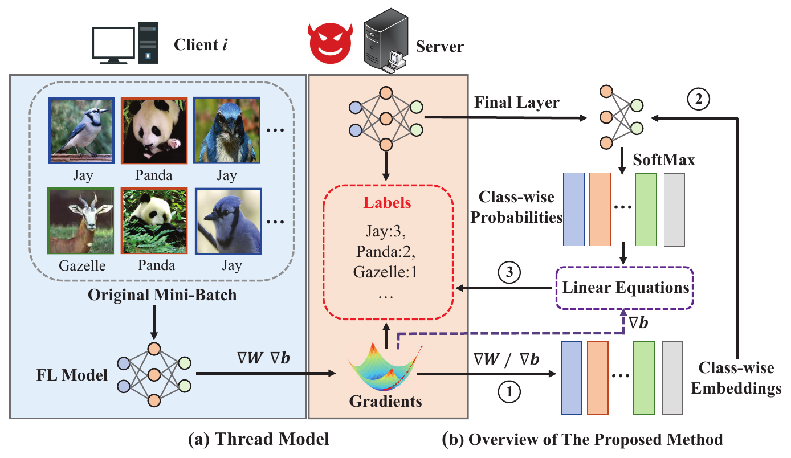
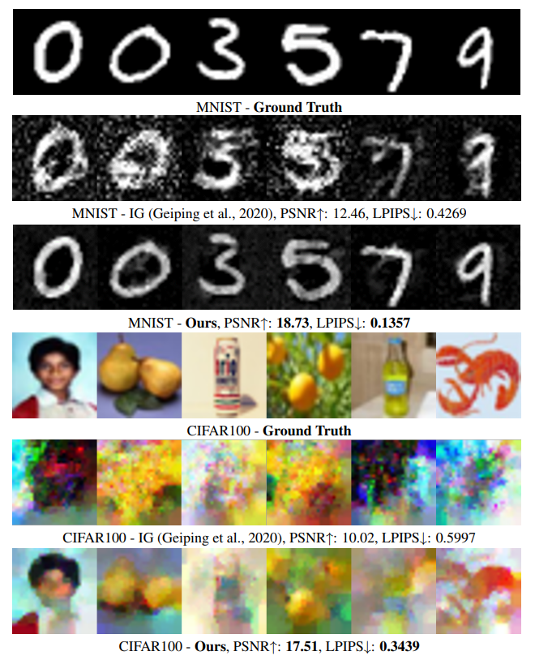

<h1 align="center">iLRG: Instance-wise Batch Label Restoration<br>via Gradients in Federated Learning</h1>

<p align="center">
  Kailang Ma<sup>*</sup>, Yu Sun<sup>*&dagger;</sup>, Jian Cui, Dawei Li, Zhenyu Guan, Jianwei Liu<br>
  <sub>School of Cyber Science and Technology, Beihang University &nbsp;&nbsp; <sup>*</sup>Co-first authors &nbsp; <sup>&dagger;</sup>Corresponding author</sub>
</p>

<p align="center">
  <a href="https://iclr.cc/Conferences/2023"><picture>
    <source media="(prefers-color-scheme: dark)" srcset="assets/figures/iclr-logo-dark.svg">
    
  </picture></a>
  &nbsp;&nbsp;&nbsp;
  <picture>
    <source media="(prefers-color-scheme: dark)" srcset="assets/figures/affiliation-buaa-cst-dark.png">
    
  </picture>
</p>

<p align="center">
  <a href="https://openreview.net/forum?id=FIrQfNSOoTr"></a>
  <a href="https://openreview.net/pdf?id=FIrQfNSOoTr"></a>
  <a href="https://iclr.cc/media/iclr-2023/Slides/11872.pdf"></a>
  <a href="https://slideslive.com/38999096/instancewise-batch-label-restoration-via-gradients-in-federated-learning"></a>
  <a href="LICENSE"></a>
  
  
</p>

<a name="overview"></a>
## 💡 Overview

Gradient inversion attacks recover a client's training data from the gradients it shares in federated
learning, and their search becomes much smaller once the labels are known. Earlier analytic methods only
identify which classes are present in a batch. iLRG restores **how many instances of each class** a batch
contains, from the gradient of the final layer alone: it recovers class-wise embeddings and post-softmax
probabilities, sets up linear equations between gradients, probabilities and labels, and solves them for
the number of instances per class with the Moore-Penrose pseudoinverse.

<p align="center">
  
</p>

- **Instance-wise label restoration** from batch-averaged gradients, beyond class presence.
- **Over 99% label existence accuracy and over 96% label number accuracy** in most cases, on three image
  datasets and four untrained classification models, with batch sizes up to 4096 and with partially
  negative activations such as Leaky ReLU and Swish.
- **Better gradient inversion**: feeding the restored labels to an existing attack raises PSNR by 6 to 7
  on both MNIST and CIFAR-100.

<a name="results"></a>
## 📊 Results

### Label restoration

Batch size 24, untrained models (Table 1 of the paper). LeAcc: label existence accuracy; LnAcc: label
number accuracy; CosSim: cosine similarity of the recovered post-softmax probabilities.

| Model | Dataset | iDLG LeAcc | GI LeAcc | RLG LeAcc | **iLRG LeAcc** | **iLRG LnAcc** | **iLRG CosSim** |
| --- | --- | ---: | ---: | ---: | ---: | ---: | ---: |
| FCN-3 | MNIST | 0.514 | 1.000 | 0.932 | **1.000** | **0.994** | **0.979** |
| LeNet-5 | CIFAR-100 | 1.000 | 1.000 | 1.000 | **1.000** | **1.000** | **1.000** |
| LeNet-S* | CIFAR-100 | 0.150 | 0.213 | 1.000 | **1.000** | **1.000** | **1.000** |
| VGG-16 | ImageNet | 1.000 | 1.000 | 0.981 | **1.000** | **1.000** | **1.000** |
| ResNet-50 | ImageNet | 1.000 | 1.000 | 1.000 | **1.000** | **1.000** | **1.000** |

<sub>*LeNet-S is LeNet-5 with Swish activations instead of ReLU (`--model lenet5 --silu`).</sub>

### Gradient inversion with restored labels

<p align="center">
  
</p>

Batch reconstruction on MNIST (FCN-3, batch size 50) and CIFAR-100 (ResNet-18, batch size 16), with and
without the labels iLRG restores (Figure 4 of the paper). The curated images are in
[`assets/reconstructions/`](assets/reconstructions); `python -m ilrg.cal_metrics` computes PSNR and LPIPS
from these saved PNGs after resizing them to the dataset's image size (28 px for MNIST, 32 px for
CIFAR-100).

<a name="installation"></a>
## 🛠️ Installation

The package needs Python 3.9 or newer and NumPy below 2 (the RLG baseline of `--compare` fails under
NumPy 2). The paper's experiments used Python 3.8 and PyTorch 1.7 with CUDA 11.0. From the repository
root:

```bash
conda create -n ilrg python=3.11
conda activate ilrg
pip install -e .
```

For a CUDA build of PyTorch, install `torch` and `torchvision` first as described on
[pytorch.org](https://pytorch.org/get-started/locally/), then run `pip install -e .`. A plain virtual
environment (`python3 -m venv .venv`) works the same way, and `requirements.txt` lists the same
dependencies.

### Data

MNIST and CIFAR-100 download into `data/` on first use. For ImageNet, put the three official ILSVRC2012
archives into `data/`: `ILSVRC2012_img_train.tar`, `ILSVRC2012_img_val.tar` and
`ILSVRC2012_devkit_t12.tar.gz`. torchvision unpacks them on the first run, which needs a few hundred GB
of free space. `--data_path` points to another folder.

<a name="quick-start"></a>
## 🚀 Quick start

Restore the labels of 24-image batches on MNIST with the three-layer fully connected network, five times,
and compare with iDLG, GI and RLG:

```bash
python -m ilrg --exp_name quickstart_mnist --dataset MNIST_GRAY --model dnn \
  --num_tries 5 --num_images 24 --compare
```

The same on CIFAR-100 with LeNet-5:

```bash
python -m ilrg --exp_name quickstart_cifar100 --dataset CIFAR100 --model lenet5 \
  --num_tries 5 --num_images 24 --compare
```

Each run writes its log to `results/runs/<exp_name>/` and ends with the mean LeAcc and LnAcc over the
tries; RLG appears as `SVD` in the logs. Add `--cpu` to run without a GPU.

### Main options

| Option | Purpose |
| --- | --- |
| `--dataset` | `MNIST_GRAY`, `CIFAR100` or `ImageNet` |
| `--model` | `dnn` (FCN, depth set by `--n_hidden`), `lenet5`, `lenetzhu`, `vgg11`/`13`/`16`/`19`, `resnet18`/`34`/`50`/`101`/`152` |
| `--num_images`, `--num_tries` | Batch size, and how many batches to average over |
| `--distribution` | How the batch labels are drawn, such as `random`, `balanced` or `custom_imbalanced` |
| `--compare` | Also run iDLG, GI and RLG |
| `--simplified` | iLRG when the classes present in the batch are known |
| `--trained_model` | Use a trained model (`--epochs`, or `--iter_train --iters`); a missing checkpoint is trained first, so create `models/` beforehand |
| `--silu`, `--leaky_relu`, `--batchnorm`, `--dropout` | Model variants |
| `--defense --defense_method` | Apply a gradient defense (`dp`, `clip` or `sparse`) before the attack |
| `--rec_img --fix_labels --save_image` | Gradient inversion with the restored labels; images go to `results/reconstructions/<exp_name>/` |

`python -m ilrg --help` lists every option.

<a name="reproducing-the-paper"></a>
## 🔁 Reproducing the paper

The commands for every experiment are in [docs/experiments.md](docs/experiments.md) (the third column
names its section), and the logs of the original runs are kept under [`results/logs/`](results/logs).

| Paper | What it shows | Commands | Archived logs |
| --- | --- | --- | --- |
| Table 1 | Label restoration against iDLG, GI and RLG | Label restoration examples (add `--silu` for LeNet-S) | `main-paper/Experiment1` (`exp3-2(swish).log` is LeNet-S), `main-paper/cos_sim` |
| Figure 2 | Different training stages | Training-stage analysis | `additional/TrainingStage` |
| Figure 3 | Batch size and model depth | Batch-size and architecture studies | `main-paper/Experiment2` |
| Figures 4 and 6 | Gradient inversion with restored labels | Gradient inversion with iLRG | `main-paper/Experiment3` |
| Tables 3 and 4 | Approximation errors over training; embedding reconstruction against Soteria | Error analysis and Soteria comparison | `additional/ErrorAnalysis&vsSoteria` |
| Table 5 | Extreme label distributions | Extreme label distributions | `additional/ExtremeDistribution` |
| Figure 5 | Differential privacy and gradient sparsification | Defense strategies | `additional/DefenseStrategy` |

The archive also keeps further runs from the original release (`main-paper/trained_models`,
`main-paper/data_distributions` and `main-paper/batchnorm&dropout`). The archived logs come from an
earlier version of the code, so their headers list a few options that no longer exist.

<a name="repository-layout"></a>
## 🗂️ Repository layout

```text
iLRG/
├── ilrg/                  # the Python package
│   ├── __main__.py        # `python -m ilrg`: parses the options, then runs main.py
│   ├── main.py            # one experiment: data, model, gradients, restoration, comparison, reconstruction
│   ├── methods.py         # iLRG and the iDLG, GI and RLG baselines
│   ├── utils.py           # batch sampling, gradients and logging
│   ├── analysis.py        # the error statistics of --analysis
│   ├── datasets.py        # datasets
│   ├── models.py          # FCN, LeNet, VGG and ResNet
│   ├── rec_imgs.py        # gradient-inversion reconstruction
│   ├── defense.py         # gradient defenses
│   ├── train.py           # training the models used with --trained_model
│   └── cal_metrics.py     # PSNR and LPIPS of the saved reconstruction PNGs
├── docs/experiments.md    # commands for every experiment
├── assets/                # README figures and curated reconstructions
└── results/logs/          # logs of the original runs
```

<a name="citation"></a>
## 📝 Citation

```bibtex
@inproceedings{ma2023instancewise,
  title     = {Instance-wise Batch Label Restoration via Gradients in Federated Learning},
  author    = {Kailang Ma and Yu Sun and Jian Cui and Dawei Li and Zhenyu Guan and Jianwei Liu},
  booktitle = {The Eleventh International Conference on Learning Representations},
  year      = {2023},
  url       = {https://openreview.net/forum?id=FIrQfNSOoTr}
}
```

<a name="acknowledgements"></a>
## 🙏 Acknowledgements

Parts of the code build on [Inverting Gradients](https://github.com/JonasGeiping/invertinggradients)
(reconstruction, training, datasets and the ResNet models), [GGL](https://github.com/zhuohangli/GGL)
(gradient defenses), [pytorch-gradual-warmup-lr](https://github.com/ildoonet/pytorch-gradual-warmup-lr)
(the warmup scheduler) and a [median pooling gist](https://gist.github.com/rwightman/f2d3849281624be7c0f11c85c87c1598)
by Ross Wightman.

<a name="license"></a>
## 📄 License

Released under the [MIT License](LICENSE).
