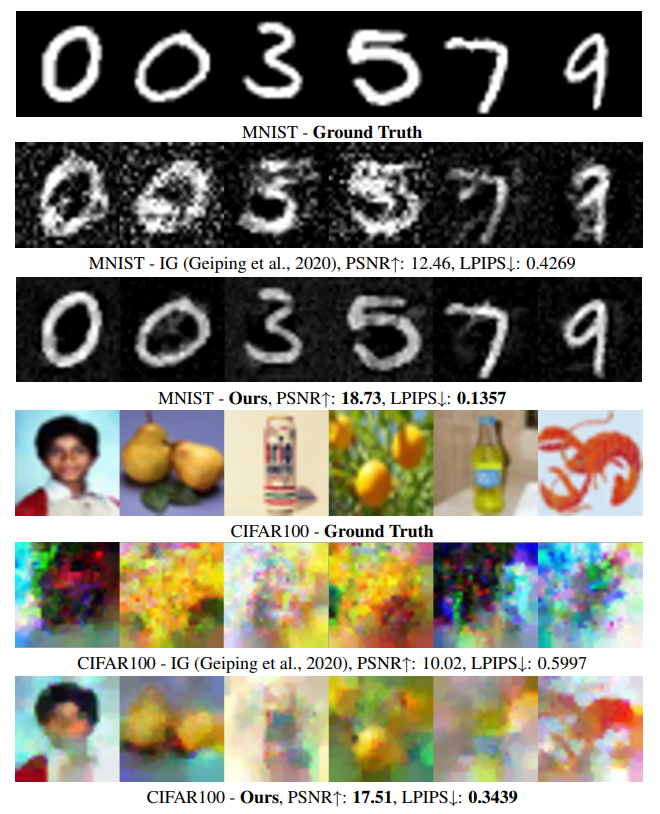

# iLRG

Official implementation of **Instance-wise Batch Label Restoration via Gradients in Federated Learning**, accepted at **ICLR 2023**.

[Paper](https://openreview.net/forum?id=FIrQfNSOoTr) · [PDF](https://openreview.net/pdf?id=FIrQfNSOoTr) · [Slides](https://iclr.cc/media/iclr-2023/Slides/11872.pdf) · [Talk](https://slideslive.com/38999096/instancewise-batch-label-restoration-via-gradients-in-federated-learning)

## Overview

iLRG analytically restores the number of instances from each class using batch-averaged gradients in federated learning. The restored labels can also improve gradient-inversion attacks by assigning a label to every reconstructed instance.

Highlights:

- instance-wise label restoration from averaged gradients;
- support for MNIST, CIFAR-100, and ImageNet experiments;
- evaluations across FCN, LeNet, VGG, and ResNet families;
- comparison with iDLG, GI, RLG, and gradient-inversion reconstruction;
- archived logs and reconstruction outputs used by the paper.

## Installation

The original experiments used Python 3.8 and PyTorch 1.7 with CUDA 11.0. Create an isolated environment, then install the dependencies:

```bash
pip install -r requirements.txt
```

MNIST and CIFAR-100 are downloaded automatically. Download ImageNet separately and place it under `data/`.

## Quick start

MNIST with the three-layer fully connected network:

```bash
python main.py \
  --exp_name quickstart_mnist \
  --dataset MNIST_GRAY \
  --model dnn \
  --num_tries 5 \
  --num_images 24 \
  --compare
```

CIFAR-100 with LeNet-5:

```bash
python main.py \
  --exp_name quickstart_cifar100 \
  --dataset CIFAR100 \
  --model lenet5 \
  --num_tries 5 \
  --num_images 24 \
  --compare
```

New runs are written to `results/runs/<exp_name>/`; reconstructed images are written to `results/reconstructions/<exp_name>/` when `--save_image` is enabled.

## Common options

| Option | Purpose |
| --- | --- |
| `--exp_name` | Name of the run and output directory |
| `--dataset` | `MNIST_GRAY`, `CIFAR100`, or `ImageNet` |
| `--model` | Model name, such as `dnn`, `lenet5`, `vgg16`, or `resnet50` |
| `--num_images` | Batch size / number of instances to restore |
| `--num_tries` | Number of repeated trials |
| `--distribution` | Batch label distribution |
| `--trained_model` | Evaluate a trained checkpoint |
| `--simplified` | Use simplified iLRG with known class presence |
| `--compare` | Compare with prior label-restoration methods |
| `--rec_img` | Run image reconstruction |
| `--save_image` | Save reconstruction images |
| `--cpu` | Run on CPU |

The complete reproducibility commands are organized in [docs/experiments.md](docs/experiments.md). Run `python main.py --help` for every available option.

## Repository structure

```text
iLRG/
├── main.py                    # experiment entry point
├── methods.py                 # iLRG and comparison methods
├── datasets.py               # dataset loading and sampling
├── models.py                  # model definitions
├── rec_imgs.py                # gradient-inversion reconstruction
├── train.py                   # model training utilities
├── assets/
│   ├── figures/               # README figures
│   └── reconstructions/       # curated reconstruction examples
├── docs/
│   └── experiments.md         # reproducibility command reference
└── results/
    ├── logs/main-paper/       # archived main-paper outputs
    └── logs/additional/       # archived additional experiments
```

The Python modules remain at the repository root so commands from the original release continue to work.

## Results

### Label restoration

| Model | Dataset | LeAcc | LnAcc | CosSim (prob.) | iDLG LeAcc | GI LeAcc | RLG LeAcc |
| --- | --- | ---: | ---: | ---: | ---: | ---: | ---: |
| FCN-3 | MNIST | **1.000** | **0.994** | **0.979** | 0.514 | 1.000 | 0.932 |
| LeNet-5 | CIFAR-100 | **1.000** | **1.000** | **1.000** | 1.000 | 1.000 | 1.000 |
| LeNet-S | CIFAR-100 | **1.000** | **1.000** | **1.000** | 0.150 | 0.213 | 1.000 |
| VGG-16 | ImageNet | **1.000** | **1.000** | **1.000** | 1.000 | 1.000 | 0.981 |
| ResNet-50 | ImageNet | **1.000** | **1.000** | **1.000** | 1.000 | 1.000 | 1.000 |

### Improved gradient inversion



The figure compares gradient inversion with iLRG-assisted reconstruction on MNIST (FCN-3, batch size 50) and CIFAR-100 (ResNet-18, batch size 16). Curated source images are available in `assets/reconstructions/`.

## Citation

```bibtex
@inproceedings{ma2023instancewise,
  title     = {Instance-wise Batch Label Restoration via Gradients in Federated Learning},
  author    = {Kailang Ma and Yu Sun and Jian Cui and Dawei Li and Zhenyu Guan and Jianwei Liu},
  booktitle = {The Eleventh International Conference on Learning Representations},
  year      = {2023},
  url       = {https://openreview.net/forum?id=FIrQfNSOoTr}
}
```

## License

This project is released under the [MIT License](LICENSE).
